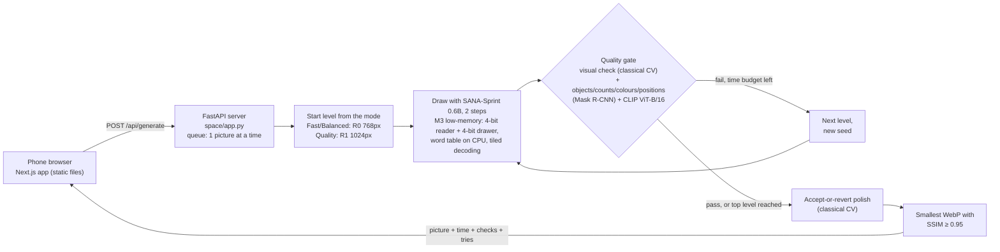
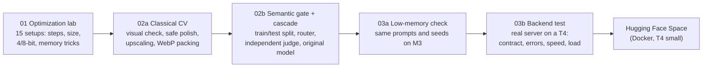

# P3 Studio: resource-efficient text-to-image for mobile devices

**Team T58** · Hackathon problem P3: *Resource-Efficient Text-to-Image Generation for Mobile Devices*

A phone-friendly web app that turns a prompt into a picture in about **1.5–3.5 seconds** on **one T4 GPU**, using
**a third of the GPU memory** of the original model. Every picture is **checked** before it is sent, both for how it
looks and for whether it matches the prompt. If a picture fails, the system tries again with more compute, so effort
is only spent where it is needed.

> **Live demo:** _link added once the Hugging Face Space is switched to its T4._
> **Cloud-assisted, not on-device:** pictures are made on a GPU server; the phone only shows the web app.

---

## Results at a glance

All numbers are **measured on a Tesla T4**. Full tables: [`eval_P3_T58.md`](eval_P3_T58.md).

**The model (notebook 01, 500 COCO prompts, FID against 5,000 real photos):**

| | Original (SANA-Sprint teacher, 20 steps) | **Ours: M3 low-memory, 2 steps** | Change |
|---|---|---|---|
| Time per picture | 6.08 s | **1.57 s** | **3.9× faster** |
| Peak GPU memory | 8.79 GB | **2.86 GB** | **−67%** |
| Model size on the GPU | 7037 MB | **2355 MB** | **3.0× smaller** |
| CLIP (ViT-L/14) | 26.60 | 26.52 | −0.09 |
| FID / KID×1000 (lower is better) | 92.4 / 9.04 | **86.2 / 6.88** | better |

**The whole system as deployed (notebooks 03a/03b, 200 held-out prompts, independent judge):**

| App mode | GenEval-style accuracy | Server time (avg) | GPU memory |
|---|---|---|---|
| Fast (cheapest level, no retry) | 60.8% | 1.48 s | ~3 GB |
| **Balanced (default)**: start cheap, retry on failure | **78.3%** | **3.42 s** | ~3 GB |
| Quality: start at full size, retry on failure | 80.0% | 3.11 s | ~3 GB |
| *Original teacher, for comparison* | *80.0%* | *6.84 s* | *8.79 GB* |

"GenEval-style" means our own re-implementation of GenEval's object, count, colour and position checks, run on the
official GenEval prompts. It is **not** the official GenEval score.

---

## How it works



Levels: **R0** = 2 steps at 768px · **R1** = 2 steps at 1024px · **R2** = 2 steps at 1024px with a new seed.
Every request runs through [`src/p3_engine.py`](src/p3_engine.py). Notebooks 03a/03b **measure exactly this code**,
so the numbers above describe what the app really runs.

**How the numbers were produced:**



Why each piece is there, and the alternatives we rejected: [`docs/DESIGN.md`](docs/DESIGN.md).

---

## Repository layout

```
├── README.md                    you are here
├── eval_P3_T58.md               evaluation file (USNs, metrics in the brief's order, all result tables)
├── docs/
│   ├── DESIGN.md                design decisions and why
│   └── LIMITATIONS_AND_ETHICS.md   limitations, failure cases, ethics
├── P3_SYSTEM_EXPLAINED.md       plain-language explainer of every stage
├── src/                         shared Python modules
│   ├── p3_engine.py             generator loading (float16/M2/M3), router, gate, cascade: one request end to end
│   ├── p3_semantic.py           prompt reader + GenEval-style checker (Mask R-CNN or Mask2Former + CLIP)
│   └── p3_classical.py          visual check, accept-or-revert polish, upscaling, WebP packing
├── notebooks/                   Colab/Kaggle notebooks (01 → 02a → 02b → 03a → 03b), plus their *_results copies
├── results/                     results downloaded from the runs (02b, 03a, 03b): CSVs, summaries, figures
├── space/                       the Hugging Face Space: app.py (FastAPI), safety.py, Dockerfile, assemble.py
├── frontend/                    the phone web app (Next.js static export) + mock API server
└── scripts/run_03b_on_kaggle.py helper to run 03b right after 03a in the same Kaggle session
```

---

## Reproduce the numbers

Each notebook runs on a free **T4** (Colab or Kaggle) except 02a (CPU). They are resumable: if a session drops, run
all cells again and finished work is skipped.

| Order | Notebook | Runtime | Produces |
|---|---|---|---|
| 1 | [`P3_01_optimization_lab.ipynb`](notebooks/P3_01_optimization_lab.ipynb) (`QUICK=False` for FULL) | T4, ~2 h FULL | speed, memory, size, CLIP, FID/KID for every setup |
| 2 | [`P3_02a_classical_cv.ipynb`](notebooks/P3_02a_classical_cv.ipynb) | CPU, ~10 min | visual check, polish, upscaling, packing results |
| 3 | [`P3_02b_router_cascade.ipynb`](notebooks/P3_02b_router_cascade.ipynb) | T4, ~1–1.5 h QUICK | checker validation, router, cascade vs original, `cascade_config.json` |
| 4 | [`P3_03a_lowmem_check.ipynb`](notebooks/P3_03a_lowmem_check.ipynb) | T4, ~40 min | float16 vs low-memory, app modes, `cascade_config_lowmem.json` |
| 5 | [`P3_03b_backend.ipynb`](notebooks/P3_03b_backend.ipynb) | T4, ~15 min | contract/error/speed/load tests of the real server, tested library versions |

- **On Colab:** notebooks read and write Google Drive (`MyDrive/P3_T2I/...`).
- **On Kaggle:** 03a and 03b set themselves up from this repository (no Drive). Choose *GPU T4 x2* and turn internet on.
  To run 03b in the same session after 03a:
  `!git -C /kaggle/working/text-image-CV pull -q && python /kaggle/working/text-image-CV/scripts/run_03b_on_kaggle.py`

---

## Run the app

**Phone app only (no GPU):** the frontend ships with a mock server that follows the same API contract.

```bash
cd frontend
npm install
npm run dev          # app on http://localhost:3000, mock API on :8787
```

**The real server locally** (needs an NVIDIA GPU; or `P3_MOCK=1` for fake pictures with real checks on a CPU):

```bash
pip install -r space/requirements.txt
cp results/03a/cascade_config_lowmem.json space/
cd space && uvicorn app:app --port 7860
```

API: `GET /api/health`, `POST /api/generate`, specified in
[`frontend/docs/API_CONTRACT.md`](frontend/docs/API_CONTRACT.md); interactive docs at `/api/docs`.

**Deploy to Hugging Face** (Docker Space, T4 small): `python space/assemble.py --config results/03a/cascade_config_lowmem.json --requirements results/03b/requirements_tested.txt --out build_space`
puts the server, the modules, the config, the tested library versions and the frontend source into one folder. The
Space's Dockerfile builds the phone app on Linux and starts the server on port 7860. No keys or tokens are stored in
this repository.

---

## Honest claims

- Speed and memory are **measured** on a T4, never estimated.
- Accuracy is **GenEval-style** and comes from an **independent judge** (Mask2Former + CLIP ViT-L/14), different from
  the gate that steers the cascade, so the system is never graded by its own checker.
- We report what didn't work too: the **router** (46.5% vs a 58% majority baseline) is not used; **counting** is our
  weakest task (55% vs 70% for the original); classical polish doesn't raise CLIP.
- Limitations, failure cases and ethics: [`docs/LIMITATIONS_AND_ETHICS.md`](docs/LIMITATIONS_AND_ETHICS.md).

## Team T58

USNs: 1RUA24CSE0335, 1RUA24CSE0340, 1RUA24CSE0347, 1RUA25CSE0553
