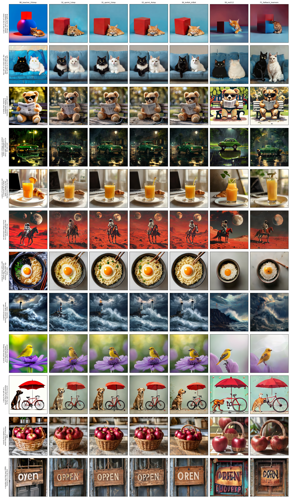
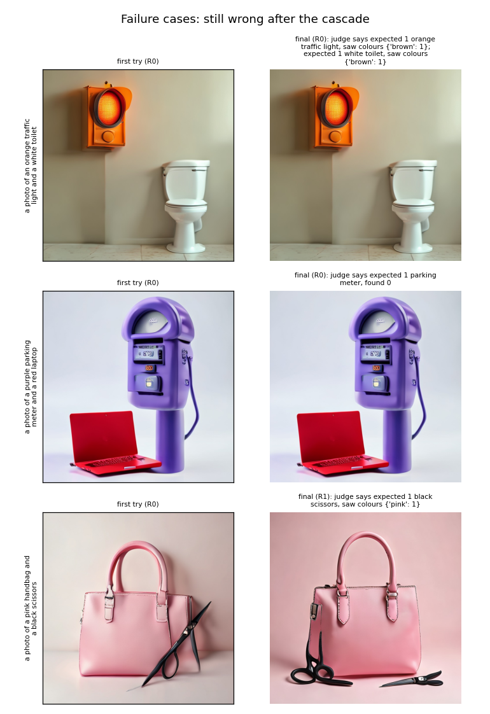
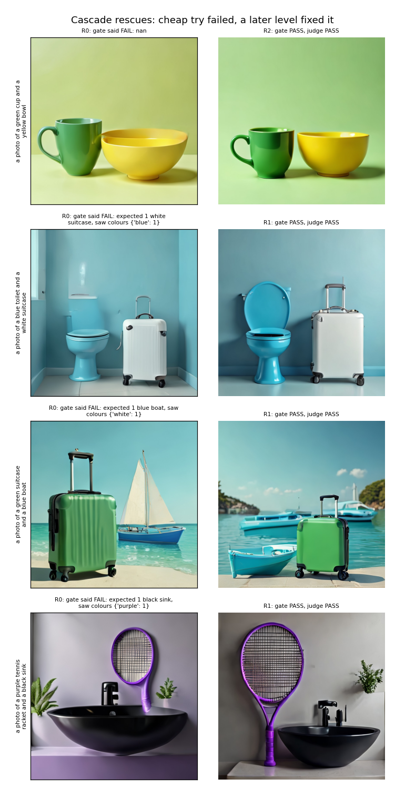

# Limitations, failure cases and ethics

Team T58 · P3 Studio. Numbers come from the notebooks and [`../eval_P3_T58.md`](../eval_P3_T58.md); nothing here is
estimated.

---

## 1. Three failure cases, why they happen, and what the quality gate did

### Failure 1: counting ("exactly five apples" → 10–15 apples)

- **What happens:** asked for an exact number, the fast model often draws too many or too few. This is our weakest
  task: GenEval-style counting accuracy is **55%** for the cascade vs **70%** for the original 20-step model (02b,
  float16, 20 counting prompts).
- **Why:** distilling 20 steps into 2 loses some fine control over layout and object count. Counting is also the
  hardest thing to *check*: on real COCO photos, our gate confirms a correct exact count only **59%** of the time
  (the independent judge 37%), because overlapping objects are hard to separate.
- **What the gate did:** the counting rule (GenEval's: *n* objects found with high confidence and not *n + 1*)
  rejects many miscounted pictures and retries with a new seed. That lifted counting from **25%** (cheapest level
  alone) to **55%**, but not to the original's 70%. Some wrong counts still pass, and some correct ones get retried.
- **Next step:** a counting-specialised detector in the gate.

### Failure 2: text inside the picture ("a sign that says OPEN" → "OPPEN", "OREN")

- **What happens:** words in the picture come out misspelled (same grid as above). The original model fails too.
- **Why:** neither the distilled model nor its teacher renders text reliably at this size.
- **What the gate did:** **nothing.** It has no OCR, so a misspelled sign passes as long as the picture looks clean
  and CLIP matches the prompt. The gate can only enforce what it can measure: COCO objects, counts, colours and
  positions, plus overall visual quality.
- **Next step:** an OCR check for prompts that contain quoted words.

### Failure 3: the checker itself is wrong on unusual appearances

The first three GenEval prompts the independent judge marked as failed after the cascade. To a human, all three
pictures look right:

| Prompt | What the picture shows | What went wrong |
|---|---|---|
| "a photo of a purple parking meter and a red laptop" | a purple parking meter and a red laptop | The **judge's** detector (Mask2Former) didn't recognise a *purple* parking meter: "found 0". The gate (Mask R-CNN) did, and passed it at R0. |
| "a photo of a pink handbag and a black scissors" | a pink handbag and black scissors | The gate rejected the first try and retried at R1. On R1's picture the judge read the **thin** scissors' colour as pink: its colour crop is dominated by the pink background. |
| "a photo of an orange traffic light and a white toilet" | an orange traffic light and a white toilet | Under warm lighting, the judge's colour test called both objects brown. |

- **What it means:** some measured "failures" are **measurement errors**, so our GenEval-style accuracy is a slight
  underestimate in places. The same weaknesses affect the gate: it agrees with the judge on 89% of pictures, is
  **too lenient on 6.5%** and too strict on 4.4%. Colour checking was not validated separately on real photos (our
  checker validation covered presence, counts and positions).
- **Why we still use two checkers:** without an independent judge we couldn't see these disagreements at all.

**Other known failures (notebook 01 hard-prompt grid):** in "a red cube on top of a blue sphere, next to a cat" the
fast model drops the sphere while the original keeps it, a real cost of distillation on three-object scenes. Spatial
relations ("umbrella to the right of the bicycle") are sometimes wrong in both models.

**When the gate does help:** 02b's rescue gallery shows the cheapest try rejected for a colour mismatch (for example a
boat with white sails where the prompt asked for a blue boat), and a retry with a new seed producing a clearly correct
picture:

---

## 2. Limitations

**What the system is**
- **Cloud-assisted, not on-device.** Pictures are made on a GPU server; the phone needs internet. We did not run the
  model on a phone.
- **One GPU, one picture at a time.** With 6 simultaneous requests, all succeed but the last one waits ~19 s.
- **Cold start.** The first boot downloads ~7 GB of model weights; a sleeping Space takes minutes to wake. Keep it on
  during demos.
- **Hosting costs money.** A T4 Space is about $0.40/hour while on. The free ZeroGPU tier didn't fit our design
  (shared GPU with per-visitor quotas; our 4-bit setup is untested there).

**What we measured, and how far it goes**
- **"GenEval-style", not official GenEval.** Same prompts and rules, our own detector-based implementation.
- **Small test set.** 120 GenEval + 80 COCO held-out prompts (QUICK mode); one GenEval prompt = 0.8 points of
  accuracy, so differences of 1–2 points are noise.
- **Only 80 object types can be checked.** Prompts about anything outside COCO's 80 classes rely on CLIP and the
  visual check only. The prompt parser understands English only.
- **Timing across machines.** Float16 results were timed on a Colab T4, low-memory results on a Kaggle T4; speed
  differences between them are approximate. Accuracy comparisons use the same prompts, seeds and judge, so they are
  exact.
- **Latency excludes the phone's network.** Server time covers drawing, checks, polish and encoding.

**Trade-offs we accepted**
- **Low memory costs a little speed:** the 4-bit model is +0.24 s per 768px picture and +0.6–0.7 s per 1024px picture
  vs float16 on a T4, in exchange for 67% less GPU memory.
- **Fast mode trades accuracy for speed:** 60.8% vs 78.3% for Balanced.
- **What didn't work:** the router (46.5% vs a 58% majority baseline) is not used; classical polish doesn't raise
  CLIP on SANA-Sprint's pictures (26.20 → 26.18). It's kept only as a safety net.

---

## 3. Ethics

**Misuse**
- Text-to-image can produce sexual, violent or hateful content, and fake pictures of real people.
- **Our safeguard is basic:** a prompt word list ([`space/safety.py`](../space/safety.py)) blocks sexual content,
  nudity, graphic violence and self-harm terms. It is **easy to get around** with paraphrases, and it also blocks
  some innocent prompts (for example "sexy car").
- **What's missing:** an image-side safety classifier, a block on named real people, and per-user rate limits. These
  are the first things to add before any real public launch.

**Bias**
- The model learned from large web datasets and will reflect their stereotypes (for example, who is shown for an
  occupation) and Western-centric defaults. **We did not measure bias:** COCO captions and GenEval prompts don't test
  it. Any public deployment should audit prompts about people.

**Copyright and style**
- Models can imitate living artists' styles or reproduce trademarked characters. We don't filter for this.

**Transparency**
- Every result shows the model name and the checks that ran. Pictures carry **no watermark or content credentials**
  yet, so a downloaded picture isn't marked as AI-generated.

**Privacy**
- No accounts, cookies or analytics. The server keeps pictures **in memory only** and logs a request's mode and prompt
  **length**, never the prompt text. The hosting provider may keep its own infrastructure logs.

**Environmental cost**
- Each picture takes **2 network passes instead of 40**, and the cascade spends extra compute only when a picture
  fails. An idle GPU still uses energy, so we switch the Space off when it isn't needed.

**Licences**
- We use pretrained weights (SANA-Sprint, the Gemma-2 text reader, Mask R-CNN, Mask2Former, CLIP) under their own
  licences, for a non-commercial student project. Anyone reusing this must check each model card's licence.

**Honest claims**
- Cloud-assisted, never "on-device"; "GenEval-style", never "GenEval"; only measured numbers, including the parts
  that didn't work.
